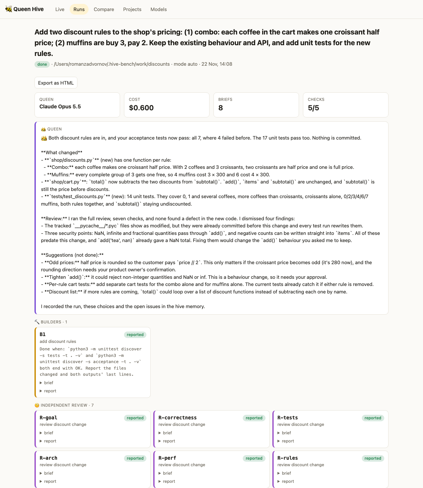

# 🐝 Queen Hive

**Guardrails, an independent review and cost tracking for AI coding agents, in Claude Code, Codex or the Gemini CLI.**

A Queen model breaks your goal into small briefs and sends cheap **worker bees** to build, scout and review. She re-runs every check herself, an independent review runs before anything is called done, hooks enforce what agents may not touch, and every job leaves a record of what was done, how it was verified and what it cost.

**It saves money with a top model as the Queen, not with a mid-tier one.** Compared like for like on [our benchmarks](#benchmarks), a hive with an Opus 5.5 Queen costs about 40% less than Opus 5.5 alone, with the same results, because the expensive model only coordinates while cheap bees do the reading and writing. With a mid-tier Queen such as Sonnet 5.5 there is little price gap left between her and the bees, so the hive's own turns (briefs, checks, review) cost more than they save: it uses more tokens than Sonnet 5.5 alone, about 25–30% more on the same results. Choose a mid-tier Queen for the guardrails and the review, not to save money.


<sub>The output of a real run from the [first benchmark](#benchmarks) (the defaults: Opus 5.5 Queen, full review), replayed faster (the run took 2 minutes).</sub>

```bash
pipx install queen-hive
hive "Fix the failing tests in ~/projects/api"
```

## What it adds to a plain agent

- **Checks that aren't on trust.** Every brief comes with a runnable *Done when*, and the Queen re-runs it herself; a failing brief goes back with the error, at most 3 times, then she asks you.
- **An independent review on record:** reviewer bees that never see the builders' reports check the work from separate lenses (goal, correctness, tests, architecture, security …), and the Queen triages every finding.
- **Guards that are enforced, not requested:** hooks block edits to protected paths (your acceptance tests), keep scouts and reviewers read-only, and stop bees from changing the hive's own rules.
- **Cost and history you can see:** tokens and cost per stage, against single models (estimated, or measured side by side with `--compare`), a live dashboard and a run history.
- **One workflow on three providers:** the same rules, bees, guards and reports in Claude Code, Codex and the Gemini CLI.
- **Memory outside your repo** and a **retro** after each job that proposes rule fixes, applied only when you approve them.

**When to use it:** work where a missed defect costs more than the tokens, where you want a record of how a change was checked, or where agents must not touch certain files. **When not to:** quick, self-contained changes. A single model does those faster and cheaper.

## Benchmarks

Two benchmarks, both on Claude, published as they came out ([bench/](bench/)), with every hive run against single
models in copies of the same repo. The defaults: Opus 5.5 Queen, Haiku 5.5 bees, full review.

**1. Five small tasks** (bug fix, feature, multi-file feature, refactor, implement-from-spec), each with a product
owner's acceptance test the hive may not edit.

| Task | Hive (Opus 5.5 + Haiku 5.5 bees) | Claude Sonnet 5.5 alone | Claude Opus 5.5 alone |
|---|---|---|---|
| dates (bug fix) | ✅ $0.22 · 1.2m | ✅ $0.06 · 0.3m | ✅ $0.20 · 0.5m |
| discounts (feature) | ✅ $0.14 · 0.8m | ✅ $0.05 · 0.2m | ✅ $0.15 · 0.5m |
| inventory (multi-file feature) | ✅ $0.14 · 1.1m | ✅ $0.06 · 0.3m | ✅ $0.24 · 0.9m |
| reports (feature + refactor) | ✅ $0.22 · 2.2m | ✅ $0.07 · 0.3m | ✅ $0.35 · 1.3m |
| ttlcache (implement from spec) | ✅ $0.17 · 1.4m | ✅ $0.07 · 0.3m | ✅ $0.36 · 1.5m |
| **Total** | **5/5 passed · $0.89** | **5/5 passed · $0.30** | **5/5 passed · $1.30** |

**2. Four realistic issues, scored on hidden tests** ([design](bench/HARDER.md)): a vague "totals are off in summer"
bug (daylight saving), an upload path-traversal fix (symlinks, absolute paths, names like `..hidden` that must keep
working), a 5× speed-up with byte-identical output, and multi-currency invoices (rounding, JPY). Agents saw only the
issue and the visible tests; hidden and regression tests were run afterwards. "hive sonnet" is a Sonnet 5.5 Queen
(light review, her default).

Each cell: hidden tests passed · regressions · cost · time.

| Task | hive | Claude Sonnet 5.5 alone | Claude Opus 5.5 alone | hive sonnet |
|---|---|---|---|---|
| invoices | 100% · 0 · $0.32 · 4.4m | 100% · 0 · $0.11 · 0.5m | 100% · 0 · $0.52 · 2.6m | 100% · 0 · $0.12 · 3.4m |
| ledger | 100% · 0 · $0.14 · 1.3m | 100% · 0 · $0.05 · 0.2m | 100% · 0 · $0.18 · 0.6m | 100% · 0 · $0.06 · 1.0m |
| report | 100% · 0 · $0.14 · 1.6m | 100% · 0 · $0.05 · 0.5m | 100% · 0 · $0.63 · 0.2m | 100% · 0 · $0.15 · 8.7m |
| uploads | 100% · 0 · $0.13 · 0.9m | 100% · 0 · $0.06 · 0.3m | 100% · 0 · $0.17 · 0.6m | 100% · 0 · $0.07 · 1.7m |
| **Total** | **4/4 correct · $0.72** · $0.18 per correct task | **4/4 correct · $0.26** · $0.06 per correct task | **4/4 correct · $1.49** · $0.37 per correct task | **4/4 correct · $0.41** · $0.10 per correct task |

**How the hive got here.** The first runs cost 3× Opus alone: the Queen read files, diffs and test logs herself, so
she spent more than one model alone on the whole task. Four rounds of changes, each measured on the same nine tasks:

Compared like for like, the hive's Queen against the same model alone:

| | Hive with an Opus 5.5 Queen, 9 tasks | Opus 5.5 alone |
|---|---|---|
| First version | $8.88 | $3.01 |
| 1. The Queen coordinates and bees read; checks return only the verdict; 5-minute cache for headless runs | (interrupted) | |
| 2. Queen effort capped at `high`; no automatic second review round; 4-line reviewer briefs | $2.94 | $2.66 |
| 3. Review sized to the change; headless runs without your personal setup | $2.05 | $2.90 |
| 4. The request passed to bees word for word; bees in the foreground; no waiting or closing turns (the hive writes the progress note) | **9/9 correct · $1.61** | 9/9 · $2.79 |

With a Sonnet 5.5 Queen, measured the same way on all nine tasks against Sonnet 5.5 alone:

| | Hive with a Sonnet 5.5 Queen, 9 tasks | Sonnet 5.5 alone |
|---|---|---|
| Full review | 8/9 correct · $1.07 | 9/9 · $0.67 |
| Light review by default, a lighter rule set, the request passed to bees word for word | 9/9 correct · $0.97 | 9/9 · $0.67 |
| Bees in the foreground (no extra turn per report), no waiting turns | 9/9 correct · $0.74 | 9/9 · $0.59 |
| No closing turn (the hive writes the progress note), 4-line summary | **9/9 correct · $0.85** | 9/9 · $0.66 |

The miss in the first row taught a lesson: the Queen, who no longer reads the code, had narrowed "the rates in
rates.json" to the currencies the issue named. Briefs now carry the user's request word for word and point to sources
instead of restating them. The last row came from tracing the Queen's turns: bees ran in the background, so each report woke her with an extra
turn, and she spent turns waiting. The last Sonnet row is within run-to-run noise of the one before: the Sonnet-Queen hive
stays about 25–30% dearer than Sonnet alone, a few cents per task, because a Queen still needs a few turns of her own
(brief, check, review, summary). With an Opus Queen the same changes paid off: about 40% less than Opus alone.

Apart from that one miss, every variant passed every task in every round, so these tasks show cost, not quality: on self-contained work of this
size the hive's checks and review didn't change a result. Each figure is one run per task, and single runs vary
(Opus alone cost $0.33–0.59 on the same task across rounds). Costs are the API-equivalent price on a Claude
subscription.

## Install

```bash
pipx install queen-hive          # or: pip install queen-hive
hive doctor                      # is your provider's CLI installed and signed in?
```

Requirements: **Python 3.10+**, **macOS or Linux**, and at least one of Claude Code, the Codex CLI or the Gemini CLI, signed in ([Provider setup](#provider-setup)).

<details>
<summary>Install from source, or check your Python version</summary>

```bash
git clone https://github.com/rzadvornov/queen-hive.git ~/queen-hive && cd ~/queen-hive
python3 -m venv .venv            # or python3.12 -m venv .venv, see below
.venv/bin/pip install -e .
ln -s ~/queen-hive/.venv/bin/hive /usr/local/bin/hive                      # macOS (may need sudo)
mkdir -p ~/.local/bin && ln -s ~/queen-hive/.venv/bin/hive ~/.local/bin/hive  # Linux, if ~/.local/bin is on PATH
```

`python3 --version` must show 3.10 or higher. macOS ships 3.9 with the Xcode tools; install a newer one:

| OS | Install a newer Python |
|---|---|
| macOS | `brew install python@3.12`, or the installer from [python.org](https://www.python.org/downloads/) |
| Ubuntu / Debian | `sudo apt update && sudo apt install python3.12 python3.12-venv`. On older releases, add the `deadsnakes` PPA first: `sudo add-apt-repository ppa:deadsnakes/ppa` |
| Fedora | `sudo dnf install python3.12` |
| Any OS | [pyenv](https://github.com/pyenv/pyenv): `pyenv install 3.12` then `pyenv local 3.12` in the repo |

The new version usually doesn't replace `python3`: call it by its full name when you create the venv (`python3.12 -m venv .venv`). If `pip install -e .` says `requires a different Python`, delete `.venv` and create it again with the newer one.
</details>

## Quick start

```bash
hive                         # first run: pick Claude, GPT or Gemini, then a folder
hive models --check          # which models your login can use
hive "Explain how this project is structured" -d ~/some/project
hive "Add a /health endpoint" --headless --done "npm test"   # scripts and CI: no interface, stops at the end
hive review                  # independent review of your uncommitted changes
hive dashboard               # live view, history, comparisons (runs in the background)
```

`hive` opens your provider's own CLI with the Queen's rules and the bees loaded, so you work in the interface you already know. When you exit, it checks the result and reports each job:

```
🐝 Hive (Claude Opus 5.5 + Claude Haiku 5.5)   ✅   $0.60   2.0m
   └ queen  ≈$0.58 · review ≈$0.02
⚖️ Claude Opus 5.5 alone                        ✅   $0.25   0.8m
acceptance ✅ $ python3 -m unittest discover -s acceptance -t .
```



## Provider setup

The first `hive` asks which AI runs the hive and remembers the answer, so it doesn't ask again:

```
🤖 Which AI should run the hive? (change it later with `hive provider`)
  ❯ 1) Claude  Claude Code
    2) GPT     Codex CLI
    3) Gemini  Gemini CLI
```

| Change it | Command |
|---|---|
| Switch for good | `hive provider gpt` (or `claude`, `gemini`); `hive provider` alone shows the menu |
| One run only | `hive "…" --provider gemini` |
| Pick by model | `hive "…" --queen gpt-5.4` uses that model's provider |

Each provider remembers its own last Queen and bee model. A Queen and her bees always come from one provider.

| Provider | Default Queen | Default bees |
|---|---|---|
| Claude | Claude Opus 5.5 | Claude Haiku 5.5 |
| GPT | GPT-5.5 with an API key; with a ChatGPT plan, the plan's own model (for example GPT-5.6-Terra) | GPT-6 Luna |
| Gemini | Gemini 3.1 Pro | Gemini 3.5 Flash-Lite |

All bees get the Haiku bees' settings, taken from `hive/core/agents/*.md`: medium effort (in the Gemini CLI, a medium thinking level), and in Codex compaction at 100k tokens.

### Claude (Claude Code)

1. Install [Claude Code](https://code.claude.com), or use the hive's own copy: `.venv/bin/pip install -e ".[bundled]"`.
2. Sign in: run `claude` and `/login`, or set `ANTHROPIC_API_KEY`.
3. `hive provider claude`, then `hive doctor`.

### GPT (Codex CLI)

1. Install it: `npm install -g @openai/codex`.
2. Sign in: `codex login` (ChatGPT plan), or set `OPENAI_API_KEY`.
3. `hive provider gpt`, then `hive models --check`. A ChatGPT plan can't use the API models (GPT-5.5 …). The hive adds the models your plan offers (it reads them from Codex) and uses them by default.
4. **Approve the hive's hooks once.** Codex runs hooks only after you approve them, and the hive's hooks guard protected paths, keep reviewers read-only and write the live log. Run this from any folder, approve the hooks when Codex asks (or type `/hooks`), then quit:
   ```bash
   CODEX_HOME=~/.hive/codex codex
   ```
   Until you do, GPT runs don't guard protected paths: in a test, a GPT run wrote a protected `.env`, and once the hooks were approved the same write was blocked. `hive` warns on each GPT run until then.
5. `hive doctor` should show `hooks: approved`.

If Codex keeps your login in the system keychain rather than in `~/.codex/auth.json`, sign in once for the hive: `CODEX_HOME=~/.hive/codex codex login`.

### Gemini (Gemini CLI)

1. Install it: `npm install -g @google/gemini-cli`.
2. Create an API key in [Google AI Studio](https://aistudio.google.com/apikey) and export it in your shell's startup file:
   ```bash
   echo 'export GEMINI_API_KEY="…"' >> ~/.zshrc     # bash: ~/.bashrc
   ```
   Google no longer serves the Gemini CLI to personal Google logins, so the key (or Vertex AI credentials) is needed. Put it in `~/.zshrc` rather than only `~/.zprofile`, which some terminals and tools don't read.
3. `hive provider gemini`, then `hive models --check`.
4. `hive doctor` warns if `GEMINI_API_KEY` isn't set.

### Where provider settings live

| What | Where |
|---|---|
| Your provider choice and last models | `~/.hive/state.json` |
| The hive's Codex home (bees, hooks, skills, sessions; your login linked in) | `~/.hive/codex` |
| The hive's Gemini home (one folder per session in `sessions/`, chat logs shared in `.gemini/tmp`) | `~/.hive/gemini` |
| Your own prices and local models | `~/.hive/models.json` |

Your own `~/.codex` and `~/.gemini` are never edited. GPT and Gemini prices come from price trackers, not the providers' pages, and models a ChatGPT plan offers show as $0 because a plan isn't billed per token. Set your own prices in `~/.hive/models.json` (the numbers below are only an example):

```json
{"prices": {"gpt-5.6-terra": {"input": 2, "output": 12, "cache_read": 0.2}}}
```

### Claude, GPT and Gemini compared

| | Claude | GPT | Gemini |
|---|---|---|---|
| Runs in | Claude Code | Codex CLI | Gemini CLI |
| Cost in the report | exact, from Claude Code | estimated from tokens × list price ($0 on a ChatGPT plan) | estimated from tokens × list price |
| Protected paths | hook | hook, once approved | hook |
| Read-only scouts | hook | Codex sandbox (read-only role) | tool list (no write or shell tools) |
| Read-only reviewers | hook | hook, once approved | instructions only (the CLI doesn't say which bee runs a tool) |
| Live log | bees when they start and report, commands with ✅/❌ | bees when they report, commands without ✅/❌ (Codex's hooks don't say either) | bees when they start and report, commands with ✅/❌ |
| Network for commands | yes | in `plan` and `auto` mode; not in `ask` mode or with `--sandbox` | yes |
| `--budget` cap, `--compare`, local bees | yes | no | no |

> GPT and Gemini have been run against signed-in CLIs (Codex 0.171, Gemini CLI 0.65) on small jobs only, so expect rough edges and run `hive doctor` first.

## What you get

- **Choose your AI and your Queen:** Claude (Fable 5.1, Opus 5.5, Sonnet 5.5 …), GPT (GPT-5.5, GPT-5.4 …, or your ChatGPT plan's models) or Gemini (Gemini 3.1 Pro, 3.8 Flash …). Any kind of bee can run on another model of the same provider (`--scout`, `--builder`, `--reviewer`). With Claude, a bee can also run on a **local model** through Ollama (`--scout qwen-coder`).
- **Runs in the CLI itself:** `hive` opens Claude Code, Codex or the Gemini CLI with the Queen's rules, the bees, the hooks and the skills loaded, then reports and records each job when you exit. Scripts and CI get a headless mode (`--headless`). In Claude Code there's also a `/queen-hive:hive` plugin command.
- **👑 and 🐝 in the chat:** on every provider the Queen starts her messages with 👑 and names bees with their icon (🔎 scout, 🔨 builder, 🧐 reviewer), and bees start their reports with `🐝 <brief ID>`. The Gemini CLI shows bees as "🔎 Scout bee" and so on; Codex as "Scout bee" (it allows no emoji in names).
- **Autonomy modes:** `plan` (you approve the briefs), `auto`, or `ask` (risky actions need a y/n).
- **Briefs with "Done when":** every brief comes with a runnable check. The Queen re-runs each check herself and returns a brief at most 3 times before asking you.
- **Independent review:** reviewer bees check the finished work from separate lenses (goal, correctness, tests, architecture, performance, rules, security), or only goal and tests with `--review light` (the default for a Sonnet 5.5 Queen). They don't see the builders' reports. `hive review` runs the same review on any diff, branch or PR.
- **Protected paths:** for example your acceptance tests. A hook blocks file edits to them, and shell writes as far as a parse of the command can tell.
- **Memory outside your project:** kept in `~/.hive/projects/…`. After each job, a retro (`waggle`) proposes rule fixes and applies only those you approve. Skip it with `--no-waggle`.
- **Statistics:** tokens and cost per stage. Each job is compared with single models, either estimated or, with `--compare` (Claude only for now), as real side-by-side runs.

## Safety: what is enforced and what isn't

- **Permissions are the CLI's.** In Claude Code, edits outside the granted folders need your approval, and in `auto` mode shell commands run without asking. Use `ask` mode, or `--sandbox` (writes only inside the granted folders), on machines that matter. Codex always sandboxes commands to the granted folders, with network in `plan` and `auto` mode only. The Gemini CLI runs them unsandboxed unless you pass `--sandbox`. In a headless run in `ask` mode, Claude Code and the Gemini CLI refuse risky actions; Codex runs them inside its sandbox.
- **Your code goes to the provider you chose:** Anthropic, OpenAI or Google, under that provider's terms.
- **Hooks are guards, not a sandbox.** The protected-path and read-only-bee checks parse shell commands; a command such as `python -c "…"` can write without being noticed. `--sandbox` is the real boundary. On GPT the hooks only run once you've approved them (see [GPT setup](#gpt-codex-cli)).
- **Acceptance commands run on your machine.** After a session the hive itself runs the acceptance commands with your shell, outside the CLI's permissions. Yours (`--done`, the profile's `test` command) always run. The Queen's own run automatically only in `plan` and `auto` mode without `--sandbox`, where she could have run them in the session anyway. In `ask` mode or with `--sandbox` you're asked first (default no), and headless runs skip them.
- **Memory feeds every later session.** The Queen writes `known-issues.md`, `decisions.md` and `progress.md`, and they go into her instructions next time. The end-of-session report lists every line she added (📝), so you can catch an instruction planted by code you don't trust.
- **`--compare` copies are contained.** Links that lead out of a copy are removed, and with `--sandbox` the solo models run sandboxed too.
- **Only the Queen changes the hive.** Retro edits to the hive's rules and bees are applied by the Queen after you approve them; the protect hook denies any bee that tries (except in the Gemini CLI, which doesn't say which bee is calling).
- **Everything stays local.** Memory, run logs and the dashboard never leave your machine, and `~/.hive` is owner-only. The dashboard listens on `127.0.0.1` and answers only its own pages, so other websites can't read it or trigger paid model checks. Local models get no login headers.

📖 **Full guide: [docs/GUIDE.md](https://github.com/rzadvornov/queen-hive/blob/main/docs/GUIDE.md)**
